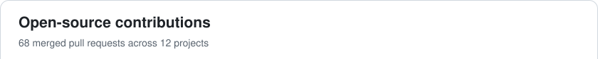

# Hi there! 👋 I'm Groot bro

> **Product Development · Architecture & Engineering · AI & Automation**

  

## 🚀 About Me

🏗️ I'm the CTO at **[#sekta](https://sektaschool.ru/?utm_source=github&utm_medium=profile&utm_campaign=grootbro&utm_content=intro)** — technical strategy, platform architecture and product delivery.  
🌳 Founder of **[MindForest](https://mindforest.us/?utm_source=github&utm_medium=profile&utm_campaign=grootbro&utm_content=intro)** — the parent company and foundation for my products and development projects.  
🌱 Building my own products through **[Ravefox](https://ravefox.dev/?utm_source=github&utm_medium=profile&utm_campaign=grootbro&utm_content=intro)** — web apps, mobile experiences, APIs and integrations.  
🤖 Working with **AI agents, OpenClaw, Codex and MCP** to automate real workflows.  
🧪 **20+ years in software development**, with a strong background in **QA engineering and team leadership**.  
📍 Based in **Thailand**. Good music, regular training, a disciplined yoga practice, and a habit of finding my way back to the ocean.

## 🛠️ Tech Stack

<b>🤖 AI & Automation</b>

<b>💻 Languages & Frontend</b>

<b>⚙️ Backend & Runtimes</b>

<b>🗄️ Data & APIs</b>

<b>🧪 Testing & Quality</b>

<b>🐳 DevOps & Observability</b>

## 🎯 What I Do

**🏗️ Product Architecture & Engineering**  
Architecture decisions, web and mobile products, APIs, payments and service integrations.

**🤖 AI & Automation**  
AI assistants, agent workflows, MCP integrations and tools that reduce repetitive work.

**👥 Technical Leadership & Quality**  
Engineering processes, team leadership, release management and reliable production systems.

## ✨ Selected Work

| Project | What I work on |
| :--- | :--- |
| 🌳&nbsp;**[mindforest](https://mindforest.us/?utm_source=github&utm_medium=profile&utm_campaign=grootbro&utm_content=selected_work)** | Founder — the parent company behind my own products and development projects. |
| 🏗️&nbsp;**[#sekta](https://sektaschool.ru/?utm_source=github&utm_medium=profile&utm_campaign=grootbro&utm_content=selected_work)** | CTO — technical strategy, architecture and delivery for a health and fitness education platform. |
| 🦊&nbsp;**[ravefox](https://ravefox.dev/?utm_source=github&utm_medium=profile&utm_campaign=grootbro&utm_content=selected_work)** | My personal platform: accounts, commerce, integrations and online radio. |
| 🔬&nbsp;**[lab](https://lab.ravefox.dev/?utm_source=github&utm_medium=profile&utm_campaign=grootbro&utm_content=selected_work)** | Web products, AI assistants and conversational project intake. |
| 📱&nbsp;**[appnative](https://appnative.pro/?utm_source=github&utm_medium=profile&utm_campaign=grootbro&utm_content=selected_work)** | Websites, AI assistants and customer workflows. |
| 🧘&nbsp;**[fysm](https://fysm.asia/?utm_source=github&utm_medium=profile&utm_campaign=grootbro&utm_content=selected_work)** | A yoga platform with retreats, digital programmes and booking experiences. |

<b>🧭 Earlier Experience</b>

I've worked across travel, fintech, music streaming and digital products, including **OneTwoTrip, Arival, Zvuk and Kaspersky**. My roles have covered hands-on QA, team leadership and release management.

That background shapes how I build today: clear behaviour, thoughtful edge cases and care for what happens after release.

## 🌱 Open Source

<!-- merged-prs:start -->

<picture><source media="(prefers-color-scheme: dark)" srcset="https://raw.githubusercontent.com/grootbro/grootbro/main/assets/open-source-summary-dark-0c6432e633af.svg"><source media="(prefers-color-scheme: light)" srcset="https://raw.githubusercontent.com/grootbro/grootbro/main/assets/open-source-summary-light-29fb8439dc51.svg"></picture><picture><source media="(prefers-color-scheme: dark)" srcset="https://raw.githubusercontent.com/grootbro/grootbro/main/assets/open-source-row-1-icon-dark-ba8eeb94e0a6.svg"><source media="(prefers-color-scheme: light)" srcset="https://raw.githubusercontent.com/grootbro/grootbro/main/assets/open-source-row-1-icon-light-a0604b43b4e1.svg"></picture><a href="https://github.com/croffasia/itsaplan/pull/841"><picture><source media="(prefers-color-scheme: dark)" srcset="https://raw.githubusercontent.com/grootbro/grootbro/main/assets/open-source-row-1-title-dark-34aad378f6c1.svg"><source media="(prefers-color-scheme: light)" srcset="https://raw.githubusercontent.com/grootbro/grootbro/main/assets/open-source-row-1-title-light-653995046879.svg"></picture></a><picture><source media="(prefers-color-scheme: dark)" srcset="https://raw.githubusercontent.com/grootbro/grootbro/main/assets/open-source-row-1-count-dark-69b8cb7241b0.svg"><source media="(prefers-color-scheme: light)" srcset="https://raw.githubusercontent.com/grootbro/grootbro/main/assets/open-source-row-1-count-light-8338eaa88c9c.svg"></picture><picture><source media="(prefers-color-scheme: dark)" srcset="https://raw.githubusercontent.com/grootbro/grootbro/main/assets/open-source-row-1-body-dark-72131c3672f0.svg"><source media="(prefers-color-scheme: light)" srcset="https://raw.githubusercontent.com/grootbro/grootbro/main/assets/open-source-row-1-body-light-1253b7fd349e.svg"></picture><picture><source media="(prefers-color-scheme: dark)" srcset="https://raw.githubusercontent.com/grootbro/grootbro/main/assets/open-source-row-2-icon-dark-19382d03be45.svg"><source media="(prefers-color-scheme: light)" srcset="https://raw.githubusercontent.com/grootbro/grootbro/main/assets/open-source-row-2-icon-light-f52d3610811e.svg"></picture><a href="https://github.com/OLYMARKES/sekta-smm-content-room/pull/4"><picture><source media="(prefers-color-scheme: dark)" srcset="https://raw.githubusercontent.com/grootbro/grootbro/main/assets/open-source-row-2-title-dark-c0313f94bc82.svg"><source media="(prefers-color-scheme: light)" srcset="https://raw.githubusercontent.com/grootbro/grootbro/main/assets/open-source-row-2-title-light-5e405c595910.svg"></picture></a><picture><source media="(prefers-color-scheme: dark)" srcset="https://raw.githubusercontent.com/grootbro/grootbro/main/assets/open-source-row-2-count-dark-f8d11a2d2f0e.svg"><source media="(prefers-color-scheme: light)" srcset="https://raw.githubusercontent.com/grootbro/grootbro/main/assets/open-source-row-2-count-light-329062b56dfc.svg"></picture><picture><source media="(prefers-color-scheme: dark)" srcset="https://raw.githubusercontent.com/grootbro/grootbro/main/assets/open-source-row-2-body-dark-755ffd3bcbb7.svg"><source media="(prefers-color-scheme: light)" srcset="https://raw.githubusercontent.com/grootbro/grootbro/main/assets/open-source-row-2-body-light-e65c9fea6c6a.svg"></picture><picture><source media="(prefers-color-scheme: dark)" srcset="https://raw.githubusercontent.com/grootbro/grootbro/main/assets/open-source-row-3-icon-dark-eabcafb9bfea.svg"><source media="(prefers-color-scheme: light)" srcset="https://raw.githubusercontent.com/grootbro/grootbro/main/assets/open-source-row-3-icon-light-56d9617ac59a.svg"></picture><a href="https://github.com/Openpanel-dev/openpanel/pull/601"><picture><source media="(prefers-color-scheme: dark)" srcset="https://raw.githubusercontent.com/grootbro/grootbro/main/assets/open-source-row-3-title-dark-fe373f097045.svg"><source media="(prefers-color-scheme: light)" srcset="https://raw.githubusercontent.com/grootbro/grootbro/main/assets/open-source-row-3-title-light-2d810a7f1fac.svg"></picture></a><picture><source media="(prefers-color-scheme: dark)" srcset="https://raw.githubusercontent.com/grootbro/grootbro/main/assets/open-source-row-3-count-dark-951fa6aa6dbb.svg"><source media="(prefers-color-scheme: light)" srcset="https://raw.githubusercontent.com/grootbro/grootbro/main/assets/open-source-row-3-count-light-fa8e64f39c5c.svg"></picture><picture><source media="(prefers-color-scheme: dark)" srcset="https://raw.githubusercontent.com/grootbro/grootbro/main/assets/open-source-row-3-body-dark-078b55d6d5b2.svg"><source media="(prefers-color-scheme: light)" srcset="https://raw.githubusercontent.com/grootbro/grootbro/main/assets/open-source-row-3-body-light-ce7a6bce5799.svg"></picture><picture><source media="(prefers-color-scheme: dark)" srcset="https://raw.githubusercontent.com/grootbro/grootbro/main/assets/open-source-row-4-icon-dark-d382803f096b.svg"><source media="(prefers-color-scheme: light)" srcset="https://raw.githubusercontent.com/grootbro/grootbro/main/assets/open-source-row-4-icon-light-05d4723a8b88.svg"></picture><a href="https://github.com/openclaw/openclaw/pull/181974"><picture><source media="(prefers-color-scheme: dark)" srcset="https://raw.githubusercontent.com/grootbro/grootbro/main/assets/open-source-row-4-title-dark-4d21fab4d7bb.svg"><source media="(prefers-color-scheme: light)" srcset="https://raw.githubusercontent.com/grootbro/grootbro/main/assets/open-source-row-4-title-light-b036bda4b833.svg"></picture></a><picture><source media="(prefers-color-scheme: dark)" srcset="https://raw.githubusercontent.com/grootbro/grootbro/main/assets/open-source-row-4-count-dark-64ff14127f82.svg"><source media="(prefers-color-scheme: light)" srcset="https://raw.githubusercontent.com/grootbro/grootbro/main/assets/open-source-row-4-count-light-112fc424d983.svg"></picture><picture><source media="(prefers-color-scheme: dark)" srcset="https://raw.githubusercontent.com/grootbro/grootbro/main/assets/open-source-row-4-body-dark-7d7d2920f0a0.svg"><source media="(prefers-color-scheme: light)" srcset="https://raw.githubusercontent.com/grootbro/grootbro/main/assets/open-source-row-4-body-light-2ac0bc208353.svg"></picture><picture><source media="(prefers-color-scheme: dark)" srcset="https://raw.githubusercontent.com/grootbro/grootbro/main/assets/open-source-row-5-icon-dark-edd1f9b20e71.svg"><source media="(prefers-color-scheme: light)" srcset="https://raw.githubusercontent.com/grootbro/grootbro/main/assets/open-source-row-5-icon-light-bdfab2845158.svg"></picture><a href="https://github.com/gobeyondpty/chatwoot-mobile-app/pull/1"><picture><source media="(prefers-color-scheme: dark)" srcset="https://raw.githubusercontent.com/grootbro/grootbro/main/assets/open-source-row-5-title-dark-511804a8294c.svg"><source media="(prefers-color-scheme: light)" srcset="https://raw.githubusercontent.com/grootbro/grootbro/main/assets/open-source-row-5-title-light-096395f9ecda.svg"></picture></a><picture><source media="(prefers-color-scheme: dark)" srcset="https://raw.githubusercontent.com/grootbro/grootbro/main/assets/open-source-row-5-count-dark-2278e8552bde.svg"><source media="(prefers-color-scheme: light)" srcset="https://raw.githubusercontent.com/grootbro/grootbro/main/assets/open-source-row-5-count-light-d84cb33cb09e.svg"></picture><picture><source media="(prefers-color-scheme: dark)" srcset="https://raw.githubusercontent.com/grootbro/grootbro/main/assets/open-source-row-5-body-dark-899bdae5c796.svg"><source media="(prefers-color-scheme: light)" srcset="https://raw.githubusercontent.com/grootbro/grootbro/main/assets/open-source-row-5-body-light-cc1f46a30e3f.svg"></picture><picture><source media="(prefers-color-scheme: dark)" srcset="https://raw.githubusercontent.com/grootbro/grootbro/main/assets/open-source-footer-dark-b788b6d147f0.svg"><source media="(prefers-color-scheme: light)" srcset="https://raw.githubusercontent.com/grootbro/grootbro/main/assets/open-source-footer-light-85ab13f2a6c7.svg"></picture>

<!-- merged-prs:end -->

[Explore my merged pull requests →](https://github.com/search?q=author%3Agrootbro+is%3Apr+is%3Amerged+is%3Apublic+-user%3Agrootbro&type=pullrequests)

## 🐍 GitHub Activity

<picture>
  <source media="(prefers-color-scheme: dark)" srcset="https://raw.githubusercontent.com/grootbro/grootbro/main/assets/github-snake-dark.svg">
  <source media="(prefers-color-scheme: light)" srcset="https://raw.githubusercontent.com/grootbro/grootbro/main/assets/github-snake.svg">
  
</picture>

## 🎧 On Spotify

  

---

**Have something worth building? [Let's talk.](https://t.me/ravefox)** 🌱

